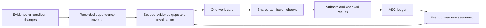

# Scoped research planning and evidence gaps

The existing ASG ledger remains authoritative. `research_dependencies.project`
derives a source → dependent graph from current evidence, research derivations,
EFSM cases/traces, delivery references, credential use and explicit revision-pinned
links. A cycle-safe traversal reports affected references and root causes. Only
recorded relationships participate: this is not a complete dependency inference engine.



Affected tests enter the waiting/human repair queue. Related delivery records are
marked stale; unrelated records remain usable. Previous observations/verdict events
are retained. Relinking an updated source requires an explicit decision; it cannot
make a missing/invalid source current or authorize execution.

```sh
python3 automation/research_dependencies.py TARGET view
python3 automation/research_dependencies.py TARGET link hypothesis:SOURCE hypothesis:CONSUMER --reason 'Uses this role-dependent observation'
python3 automation/research_dependencies.py TARGET gap --input PRIVATE_GAP.json
python3 automation/work_dispatch.py TARGET --config PRIVATE_ROUTING.json --preview
```

A gap declaration supplies `gap_id`, existing `goal` and `criterion`, `established`,
`question`, competing `alternatives`, normal `control`, required `observe`,
`support_limit`, current pinned `evidence` and optional capability `requires`.
For example, visible content after revocation leaves a cache-versus-new-server-access
gap; the next question should capture a fresh request and protected response marker.

Configure `evidence-gap-analysis` with the existing `analysis` adapter. Its checked
proposal goes through exploration review and then the ordinary hypothesis gates.
Designing or running a test does not close the gap. Only the original goal criterion's
accepted evidence resolves it; changed evidence reopens it. Rejected/stale/unready
work remains visible, without automatic repeated model calls.

`work_dispatch.preview` and real dispatch use the same admission implementation.
Preview reads the current snapshot, creates no lock/receipt/work, and never obtains
credential values. It does not apply fresh ingress or grant authorization. Admission
is checked again when dispatch changes state. Exact declared comparison signatures
include claim, roles/context, operations, scope, predicates and original evidence;
changing an ID alone cannot repeat one. Unknown claims stay separate. Independent
verification is not deduplicated against the producer's comparison.

Snapshots/handoffs and the planning `view` expose evidence/task metrics, model calls
and elapsed time observed in typed dispatch, tool calls, gap states and duplicate
comparison dispatches. Missing historical/provider token and cost telemetry remains
`null`. These counters do not measure correctness, missing vulnerabilities or total
legacy Harness cost; representative task evaluation is still required.

Design references: [W3C PROV derivation](https://www.w3.org/TR/prov-dm/#term-Derivation)
supports explicit source relationships; [Hypothesis stateful testing](https://hypothesis.readthedocs.io/en/latest/stateful.html)
informs sequence-based regression cases. Reuse/adapt decision: extend existing ledger,
evidence checks and controlled executor; add no RDF database or separate orchestrator.
